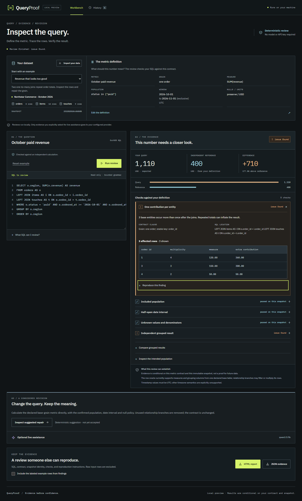

# QueryProof

A local workbench for analysts reviewing SQL business metrics. Compare a query with an explicit metric contract, inspect the rows behind a discrepancy, try a revision, and export evidence another reviewer can reproduce.

**Verified local workflow, with explicit scope limits.** See the [requirement/evidence map](docs/ACCEPTANCE.md) and [verification](docs/VERIFICATION.md). Successful SQL execution is not proof that a business definition is correct.



[Watch the captioned walkthrough](https://raw.githubusercontent.com/ngyathin16/queryproof/main/docs/walkthrough.mp4) · [Read the captions](docs/walkthrough.vtt) · [Interface design](docs/DESIGN.md)

## Run locally

Requires Python 3.12–3.14, [uv](https://docs.astral.sh/uv/), and Node.js 24. The default workflow needs no account or API key.

```sh
git clone https://github.com/ngyathin16/queryproof.git
cd queryproof
uv sync --frozen
cd ui
npm ci
npm run build
cd ..
uv run queryproof
```

Open <http://127.0.0.1:4317>. On Windows, use `npm.cmd` if PowerShell blocks `npm.ps1`. The repository is public and can be cloned without an account.

Choose the inflated-revenue example, read its contract, and run the review. Inspect the join evidence, load the deterministic proposal, then run the revision. The original remains in History. Correct-query and missing-definition examples demonstrate different outcomes. JSON and HTML exports omit source-row examples unless explicitly selected. CSV input files are never included in reports.

The interface also accepts a JSON bundle with a `manifest` and a `files` map of CSV filenames to UTF-8 text, or a manifest plus selected CSV files. Limits are five tables, 100 MB of CSV input and one million rows. Empty CSV fields mean SQL NULL. Imports stay on this computer. Snapshot identity is based on content, not filenames or a changeable dataset label.

Stop the server with Ctrl+C. Reset in the interface restores the example without erasing history. To start with an empty history, stop it and run `uv run queryproof --data-dir data-fresh`. Review databases are private local data and ignored by Git.

## Optional local model

The default adapter uses a local Ollama model, `qwen3.5:9b`. Run Ollama separately and install the model with `ollama pull qwen3.5:9b`. Set `QUERYPROOF_MODEL` to another installed model if needed. `QUERYPROOF_OLLAMA_URL` accepts only a loopback HTTP origin. See [model selection](docs/MODEL-SELECTION.md) for primary-source research and task-specific comparison results.

Assistance is explicitly requested after deterministic analysis. The interface discloses the evidence shared with the local model. Runs are limited to eight diagnostic tool calls, 60 seconds and 2,048 generated tokens. Proposals pass through the same SQL restrictions and execution path. Model failure leaves the deterministic review intact. Model prose is advice; executed checks determine the result.

People who prefer a hosted provider can configure an OpenAI-compatible API and their own key on the server. Local inference remains the default. Keys are never entered into the browser or stored in review history. Hosted assistance sends the disclosed evidence only after the reviewer opts in and can incur the provider's charges. No paid model call was made during development. Configuration and verification scope are documented in [provider setup](docs/MODEL-SETUP.md).

## Verify

```sh
uv run python -m unittest discover -s tests -v
uv run python scripts/evaluate.py --help
uv run python scripts/evaluate.py --suite v2
```

With the application running, `cd ui` and run `npm run verify` for the actual browser workflow and automated accessibility checks. It uses Edge on Windows; elsewhere install Playwright Chromium with `npx playwright install chromium`. `npm run walkthrough` captures the captioned walkthrough from the real application. These commands create test reviews in the chosen server's local history; use a separate `--data-dir` if you want to keep them apart from your own reviews.

The evaluation folder contains versioned cases, independent expected results, a frozen hash and [recorded outcomes](evaluation/RESULTS.md). Read its manifest before using the numbers; development/regression results are not proof of unseen-case accuracy. Browser checks, screenshots and remaining release gates are recorded in [verification](docs/VERIFICATION.md).

The [second frozen suite](evaluation/v2/manifest.json) adds six different schema and relationship patterns, including legitimate repeated relationship keys, nonadditive ratios, signed compensation and floating-point rounding. Its first-run miss and subsequent fix are retained separately. Relationships may specify `source_table` to connect an earlier joined table to the next branch; omitted `source_table` means the metric's base table.

## Architecture and limits

The React/TypeScript interface talks to a Python loopback service. SQLite preserves snapshots and immutable review inputs. SQLGlot enforces an explicit syntax allowlist. A disposable DuckDB worker executes only application-owned tables with external access and extension loading disabled, a memory budget, and timeout/cancellation termination. A separate row/Decimal calculation derives expected results from the contract. See [architecture](docs/ARCHITECTURE.md) for the supported scope and tradeoffs.

This is a single-user local application, not a production database gateway. It does not connect to warehouses, run arbitrary SQL or infer missing business definitions. Static website hosting cannot run it. Imported data is bounded but can still use substantial memory; do not expose the local service to a network.

## Provenance and contribution

Harold Ng specified the product and reviews its engineering decisions. Implementation, synthetic fixtures, evaluation cases and automated checks were produced with OpenAI Codex assistance. No customer or employer data is included. The commerce records are fictional, authored for this project and not empirical business results. Agent/browser checks do not count as human usability validation.

The problem is informed by [OpenAI's data-agent discussion](https://openai.com/index/inside-our-in-house-data-agent/), [Anthropic's tool-design guidance](https://www.anthropic.com/research/writing-tools-for-agents) and [agent evaluation guidance](https://www.anthropic.com/research/demystifying-evals-for-ai-agents). No affiliation or endorsement is implied. Runtime restrictions follow [DuckDB security guidance](https://duckdb.org/docs/current/operations_manual/securing_duckdb/securing_extensions); parsing uses [SQLGlot](https://sqlglot.com/).

No new source-code license has been selected. Dependency licenses remain with their owners; repository visibility does not grant a license. See [change record](docs/CHANGELOG.md).
